<p align="center">
  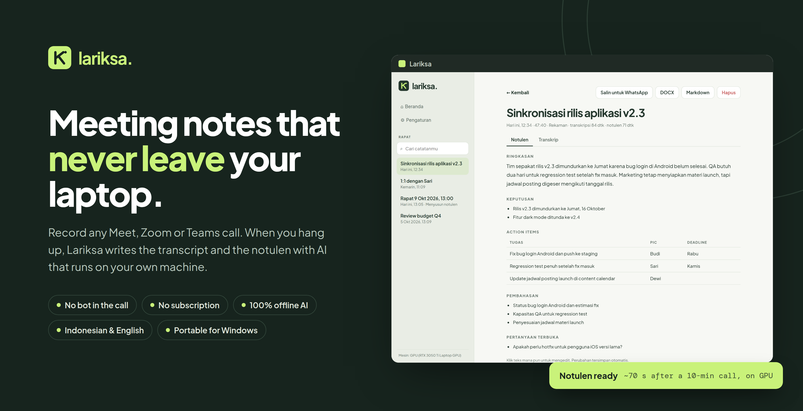
</p>

<p align="center">
  <b>Portable meeting notes for Windows.</b> Record any Meet, Zoom or Teams call; when you hang up, Lariksa writes the transcript and the <i>notulen</i> (meeting minutes) with AI that runs on your own machine.<br>
  No bot in the call · no subscription · nothing uploaded.
</p>

<p align="center">
  <a href="https://github.com/daefery/lariksa/releases/latest/download/Lariksa-portable.zip"></a>
  <a href="https://github.com/daefery/lariksa/releases/latest/download/Lariksa.exe"></a>
</p>

<p align="center">
  <a href="LICENSE"></a>
  
  
  
</p>

---

## How it works

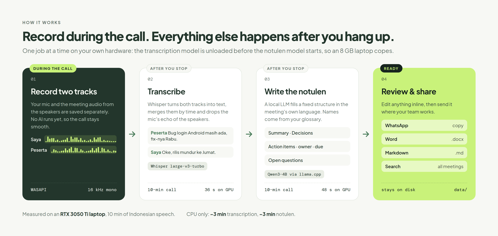

1. **Record.** Press **Rekam**, or **Ctrl+Shift+R** from inside Zoom, Meet or Teams. Your microphone ("Saya") and the meeting audio from your speakers ("Peserta") are saved as two separate tracks. No AI runs during the call, so it stays smooth. A small always-on-top indicator shows the timer, live levels and a **Selesai** button, and never takes focus from the meeting; press the shortcut again or click **Selesai** to stop. While the notulen is being written, the same indicator (and the taskbar icon) shows the stage and progress.
2. **Transcribe.** Press **Selesai**. Whisper large-v3-turbo turns both tracks into text, merges them by time and drops the mic's echo of the speakers. The track tells it who spoke, so no speaker-detection model is needed.
3. **Write the notulen.** A local LLM (Qwen3-4B via llama.cpp) reads the transcript as numbered lines and answers with line numbers, so every chapter, action item, decision and open question points back to the exact moment it came from. Code, not the model, turns those references into timestamps, matches owners to real speakers, keeps a deadline only if it was actually said, and drops anything that cites a line that does not exist. Whisper is unloaded first, so an 8 GB laptop copes.
4. **Review and share.** Action items are grouped by owner with checkboxes; every item has a timestamp that jumps to that moment in the transcript and plays the audio from there. Chapters sit in a side rail, with talk time per speaker. Edit anything inline, then copy it to WhatsApp or export to Word or Markdown. Every meeting is searchable.

Already have a transcript from Read.ai, Google Meet, Zoom or Teams? Import the `.txt` or `.vtt` and Lariksa writes its notulen from it, no audio needed.

You can start the next meeting while the previous one is still processing; jobs run one at a time, in order. If the app closes mid-meeting, the recording is kept and processing resumes on the next start.

## What you get

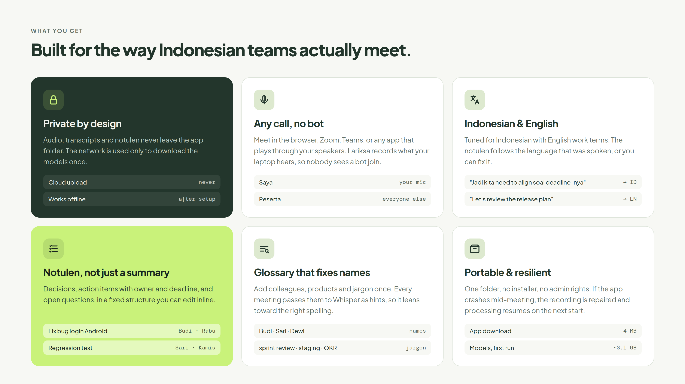

## The notulen speaks the language of the meeting

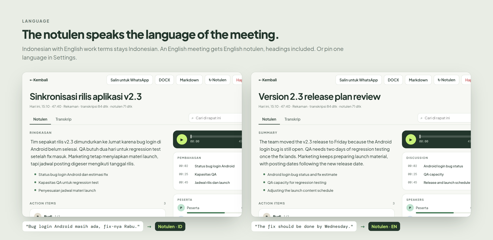

Indonesian with English work terms ("Jadi kita need to align soal deadline-nya") stays Indonesian. An English meeting gets English notulen, headings included, on screen and in every export. You can also pin one language in **Pengaturan** (Settings).

## The app

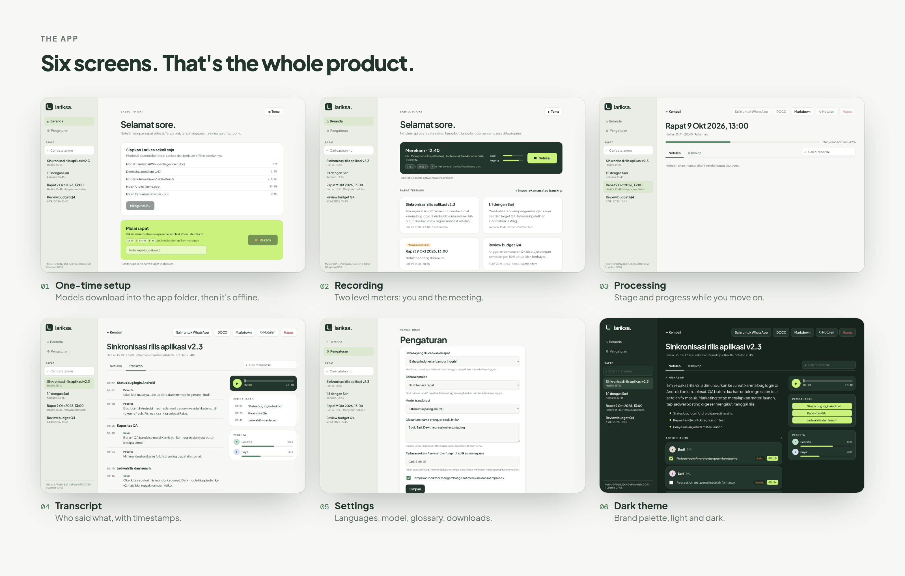

<details>
<summary>Full-size screenshots</summary>

| | |
|---|---|
| 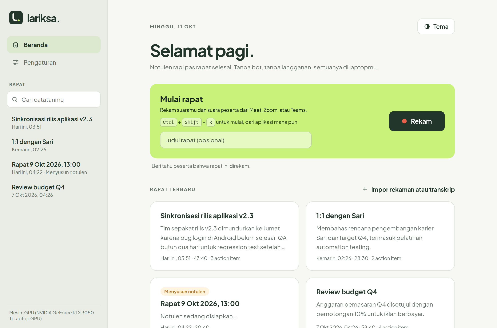 | 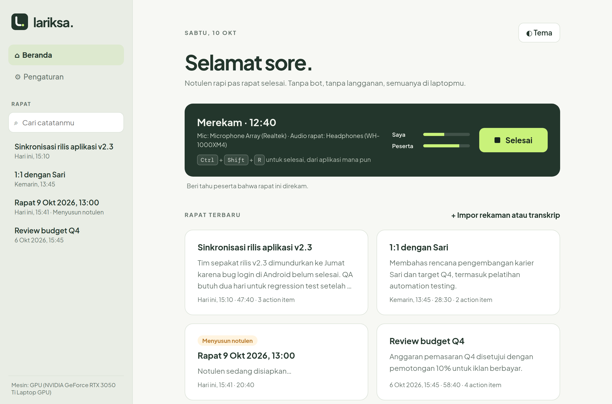 |
| **Home.** Recent meetings and the record button. | **Recording.** Live levels for you and the meeting. |
| 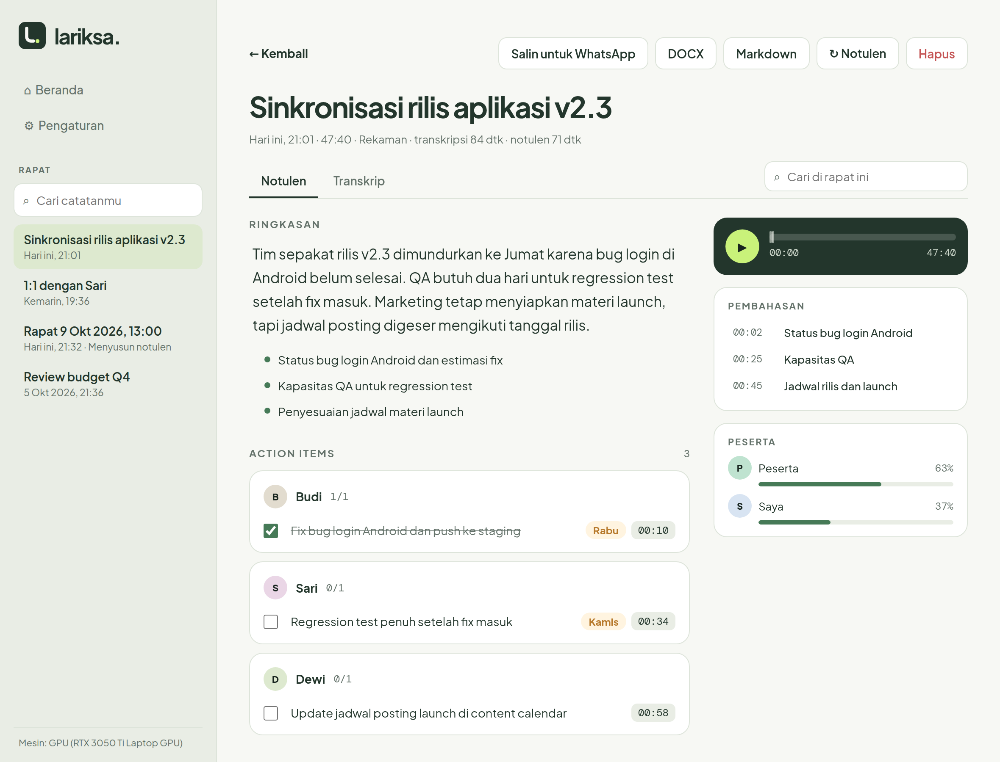 | 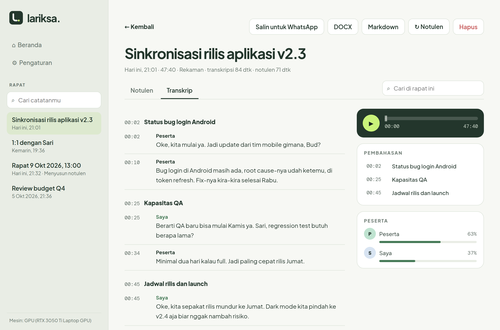 |
| **Notulen.** Click any text to edit; it saves automatically. | **Transcript.** Who said what, with timestamps. |
| 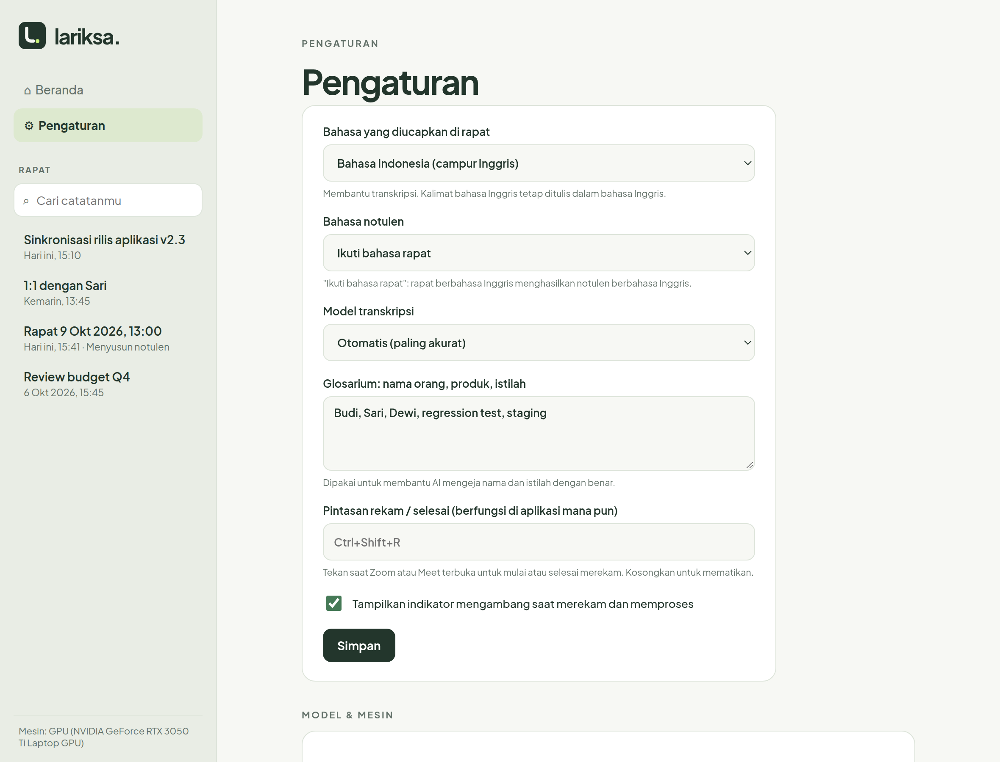 | 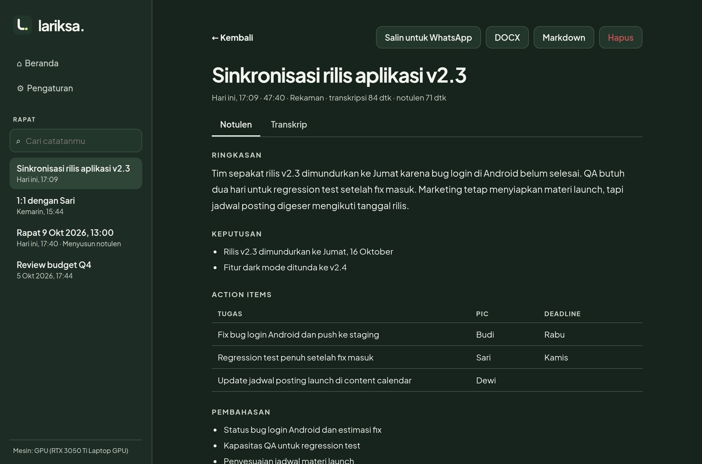 |
| **Settings.** Languages, model, glossary, downloads. | **Dark theme.** |

</details>

All screenshots show fictional sample data, rendered from the real UI code.

## Speed

Measured on an RTX 3050 Ti laptop (4 GB VRAM), i7-12650H, 10 minutes of real Indonesian speech:

| Step | NVIDIA GPU | CPU only |
|---|---|---|
| Transcription (Whisper large-v3-turbo) | **21 s** | 198 s |
| Notulen (Qwen3-4B Q4_K_M) | **48 s** | ~200 s |

A 1-hour meeting needs about 5 minutes after you stop on that GPU (estimated, not yet measured).

## Download

| | File | Size | |
|---|---|---|---|
| **Recommended** | [**Lariksa-portable.zip**](https://github.com/daefery/lariksa/releases/latest/download/Lariksa-portable.zip) | 96 MB | Extract anywhere, run `Lariksa\Lariksa.exe`. Opens fastest. |
| Single file | [**Lariksa.exe**](https://github.com/daefery/lariksa/releases/latest/download/Lariksa.exe) | 96 MB | One file. Put it in its own folder: models and meetings are saved next to it. Opens a few seconds slower. |

Both links always point to the [latest release](https://github.com/daefery/lariksa/releases/latest); checksums are in [`SHA256SUMS.txt`](https://github.com/daefery/lariksa/releases/latest/download/SHA256SUMS.txt). Or [build it yourself](#build-from-source).

**Requirements:** Windows 10 2004+ or Windows 11 (x64), 8 GB RAM (16 GB recommended), about 6 GB of free disk. An NVIDIA GPU is optional and makes transcription about 9x faster.

## Get started

1. Download one of the files above. No installer, no admin rights: Documents or an external drive both work.
2. Run `Lariksa.exe`. If Windows shows "Windows protected your PC", choose **More info → Run anyway** (the app is not code-signed yet).
3. Click **Unduh semua** (download all) once, about 4 GB. After that Lariksa works offline.
4. In **Pengaturan**, add your colleagues' names and team jargon to the glossary.
5. Tell participants the meeting is recorded, press **Rekam**, and **Selesai** when you're done.

Everything (models, runtime and your meetings in `data/`) lives in the app's folder. Copy it to another laptop and your meetings come with it.

## Architecture

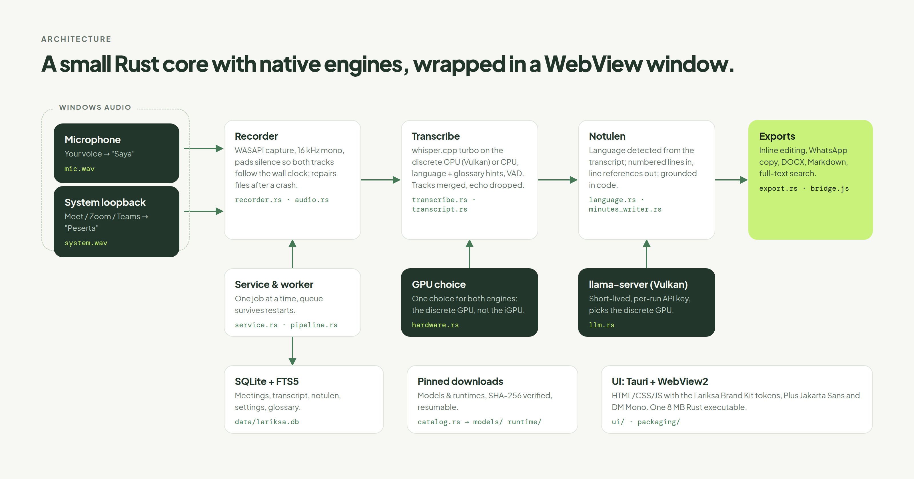

| Module | Responsibility |
|---|---|
| `recorder.py`, `audio.py` | WASAPI two-track capture, 16 kHz mono, wall-clock padding, crash repair |
| `transcribe.py`, `hardware.py` | faster-whisper with Indonesian defaults; CUDA or CPU choice |
| `transcript.py` | Utterances, track merge, echo removal |
| `language.py` | Which language the notulen is written in |
| `notulen.py`, `llm.py` | Prompts, JSON schema, map-reduce for long meetings; llama-server lifecycle and GPU choice |
| `pipeline.py` | Transcribe then summarise, with injected engines |
| `store.py` | SQLite + FTS5 search, settings, glossary |
| `service.py`, `bridge.py`, `app.py` | Worker queue, downloads, recovery; JavaScript API; window |
| `catalog.py` | Pinned, SHA-256-verified, resumable downloads |
| `ui/` | HTML/CSS/JS with the Lariksa Brand Kit tokens, Plus Jakarta Sans, DM Mono |

## Build from source

On Windows, with no system Python needed (uv and Python are fetched into `.tools/`):

```powershell
powershell -ExecutionPolicy Bypass -File packaging\build.ps1
```

This runs the tests and produces the app folder `dist\Lariksa\` plus the release files in `dist\release\`: `Lariksa-portable.zip`, the single-file `Lariksa.exe` and `SHA256SUMS.txt`. Models download inside the app on first run.

Develop:

```powershell
packaging\dev.cmd sync --group dev
packaging\dev.cmd run pytest -q
packaging\dev.cmd run python -m lariksa.app
```

On Linux or WSL everything except the recorder and the window runs, which covers the tests and the pipeline:

```bash
uv sync
uv run pytest -q                          # 69 tests; the WASAPI test runs only on Windows
uv run python scripts/preview.py out/     # UI screenshots in headless Chrome with a stub API
uv run --with pyoxipng python docs/visuals/render.py   # regenerate the README visuals
```

Bench scripts in `scripts/`: `bench_asr.py` (Whisper settings side by side), `bench_notulen.py`, `bench_llm.py`, and `smoke.py` (the full pipeline through the service, no UI).

## Brand

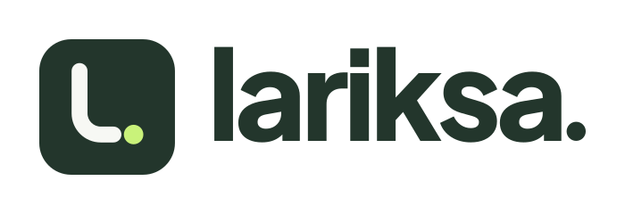

The mark is a soft “l” that turns into a written line (*larik*, a line of writing) and ends in a lime full stop: the moment the minutes are done. Logo files, usage rules and the generator are in [`brand/`](brand/README.md).

## Privacy and consent

Audio, transcripts and notulen stay in the app folder. The network is used only to download models and runtimes. Recording other people may require their consent where you live; the app reminds you to tell participants.

## Licence

Code: [Apache License 2.0](LICENSE). See [NOTICE](NOTICE) for third-party attributions.

The Lariksa name, logo and icon are not covered by the code licence; see [TRADEMARKS.md](TRADEMARKS.md). Forks are welcome under their own name.

Third-party components, none of which are redistributed in this repository except the fonts:

- [faster-whisper](https://github.com/SYSTRAN/faster-whisper) (MIT), [CTranslate2](https://github.com/OpenNMT/CTranslate2) (MIT), [llama.cpp](https://github.com/ggml-org/llama.cpp) (MIT), [pywebview](https://github.com/r0x0r/pywebview) (BSD-3-Clause), [PyAudioWPatch](https://github.com/s0d3s/PyAudioWPatch) (Apache-2.0), [python-docx](https://github.com/python-openxml/python-docx) (MIT), [PyAV](https://github.com/PyAV-Org/PyAV) (BSD-3-Clause)
- Models downloaded at first run: Whisper large-v3-turbo (MIT), Qwen3-4B-Instruct-2507 (Apache-2.0). NVIDIA cuBLAS and cuDNN are downloaded from PyPI under NVIDIA's licence.
- Whisper setup patterns adapted from [AutoClip](https://github.com/artbyjazi/autoclip) (MIT, Jad Ghazi); notice in [NOTICE](NOTICE).
- Fonts: Plus Jakarta Sans and DM Mono, SIL Open Font License 1.1 (`src/lariksa/ui/fonts/`).
