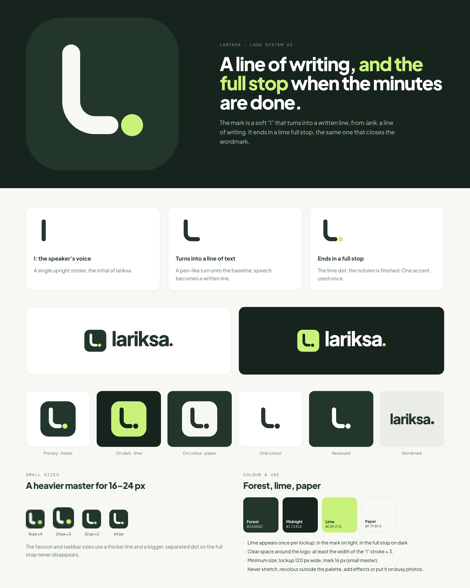

# Lariksa logo



**The idea.** A soft "l" that turns into a written line (*larik* is Indonesian for a line of writing) and ends in a lime full stop: the moment the minutes are done. The same full stop closes the wordmark, `lariksa.`

**The wordmark** is "lariksa" set in Plus Jakarta Sans ExtraBold at -4.5% tracking, converted to outlines. The font is under the SIL Open Font License 1.1, which allows using it in a logo.

## Files

| File | Use |
|---|---|
| `logo/mark-forest.svg` | **Primary.** App icon, avatars, anywhere on light |
| `logo/mark-forest-small.svg` | Favicon and taskbar, 16–24 px only (heavier line, bigger stop) |
| `logo/mark-lime.svg` | On dark backgrounds |
| `logo/mark-paper.svg` | On forest or other brand colour |
| `logo/mark-mono-forest.svg`, `mark-mono-white.svg` | One colour, no tile (print, stamps, embossing) |
| `logo/lockup-light.svg`, `lockup-dark.svg` | Mark + wordmark, for headers, slides, documents |
| `logo/lockup-mono-*.svg` | One-colour lockups |
| `logo/wordmark-forest.svg`, `wordmark-white.svg` | Word only, where the mark already appears nearby |
| `logo/lariksa.ico` | Windows icon: 16, 24, 32 (small master), 48–256 |
| `logo/png/` | PNG exports: app icon 16–1024 px, variants at 512 px, lockups at 2x |

All SVGs are filled outlines (no fonts, no strokes), so they look identical in browsers, Figma, Illustrator, Inkscape and Office.

## Rules

- Lime appears once per lockup: in the mark on light backgrounds, in the full stop on dark ones.
- Clear space: at least three times the stroke width of the "l" on every side.
- Minimum size: the mark at 16 px (use the small master below 32 px), the lockup at 120 px wide.
- Don't stretch it, recolour it outside forest/midnight/lime/paper/white, add shadows or gradients, or place it on busy photos.

Colours: forest `#23362C`, midnight `#17241E`, lime `#C9F27A`, paper `#F7F8F4`.

## Regenerate

Everything is built from the numbers in `build_logo.py`; change them there, never by hand-editing an SVG.

```bash
uv run --with fonttools --with brotli python brand/build_logo.py   # SVGs
uv run --with pillow python brand/export_logo.py                   # PNGs + .ico
```

The logo is not covered by the code licence; see [TRADEMARKS.md](../TRADEMARKS.md).
